<p align="center">
  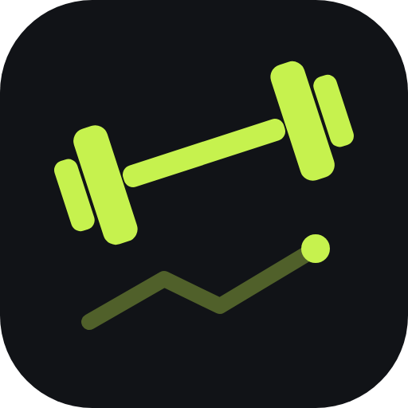
</p>

<h1 align="center">GymLog</h1>

<p align="center">
  <b>A workout log that replaces the notes app on your phone.</b><br>
  Animated exercises, one-tap "copy last workout", plans and progress charts. Free, offline, no account.
</p>

<p align="center">
  <a href="https://kaansoyaslan.github.io/gymlog/"><b>▶ Open the app</b></a>
  &nbsp;·&nbsp;
  <a href="https://kaansoyaslan.github.io/gymlog/?demo">Try the demo</a>
  &nbsp;·&nbsp;
  <a href="#türkçe">🇹🇷 Türkçe</a>
</p>

<p align="center">
  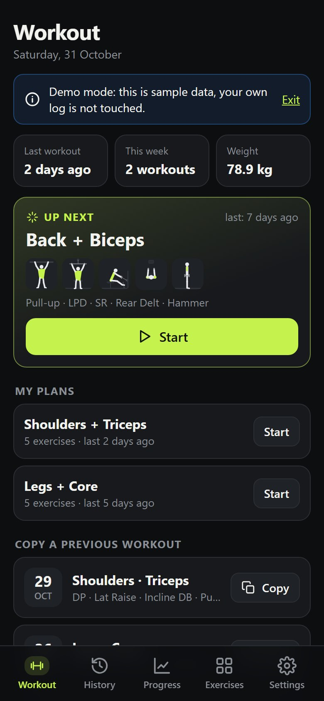
  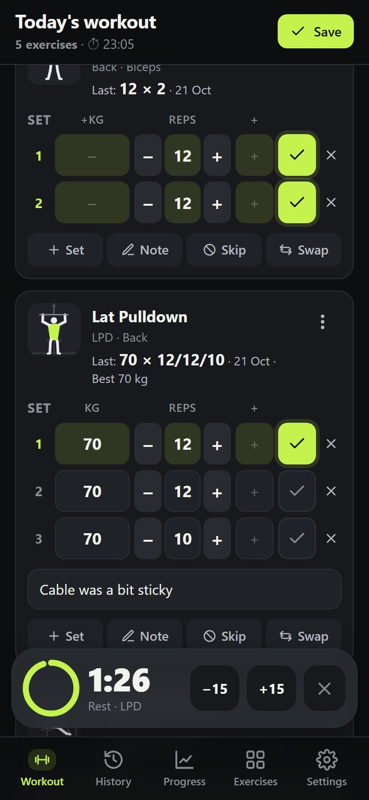
  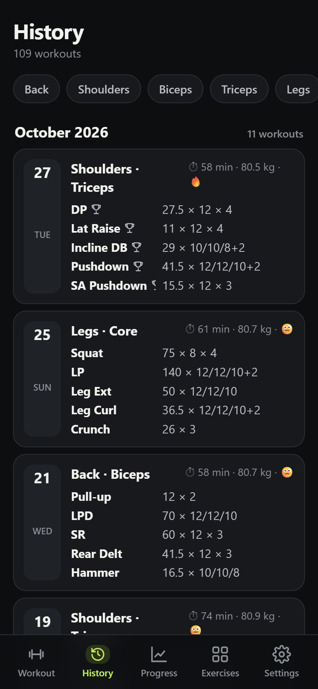
</p>
<p align="center">
  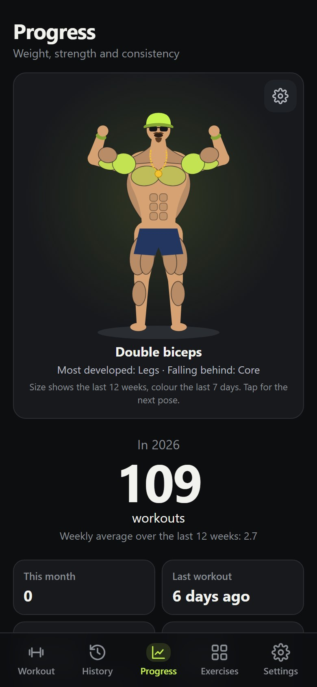
  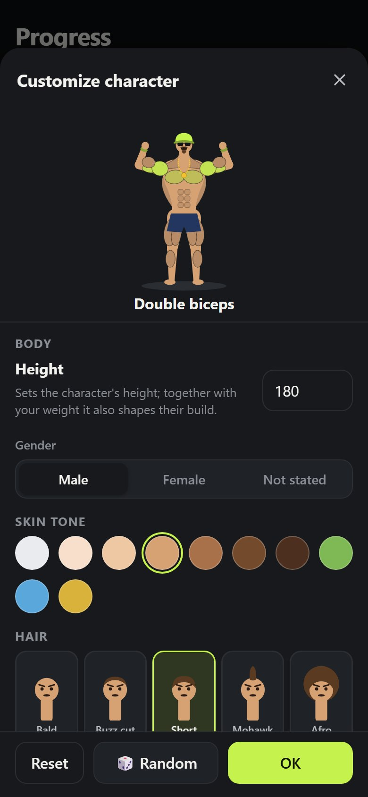
  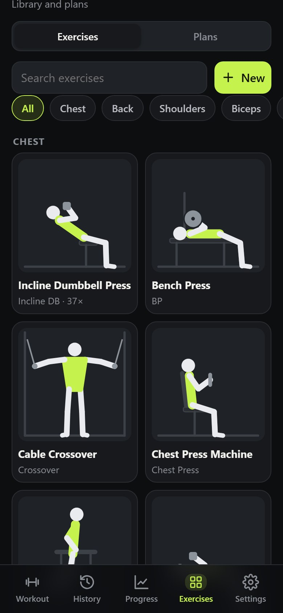
  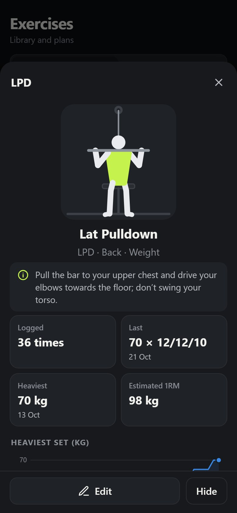
</p>

## Overview

GymLog started as a plain text file on a phone: a date with the body weight in brackets, then one line per exercise such as `lpd 54x12 x3`. It worked, but there were no charts, no way to see last week's numbers at a glance, and every workout was typed from scratch.

GymLog keeps that speed and adds the rest. Start a workout by copying a previous one or a saved plan, tick off your sets while the rest timer runs, take the suggested weight when you are ready to go up, and save. Every exercise has a small animation, so abbreviations like `LPD` or `D Rise` turn into something you can recognise. Your old notes can be pasted in once and are converted automatically.

It is a progressive web app (PWA): it runs in the phone's browser, can be installed to the home screen and works offline at the gym. There is no server and no account; everything is stored on your device. The interface is available in English and Turkish, in dark or light mode with 18 accent colours, and it is built to feel good to use: screens slide in, buttons ripple, and the phone vibrates when you complete a set.

## Features

**Logging**
- Pick the muscle groups for the day (chest, back, shoulders, biceps, triceps, legs, core, cardio) and choose exercises from those groups, or search by name or abbreviation.
- Per set: weight, reps (type them or use the −/+ buttons) and drop reps: the extra reps you squeeze out after dropping the weight at the end of a set (`12+4`). Every box is labelled (KG, REPS, DROP). Bodyweight, timed and cardio exercises have their own fields.
- Last time's numbers appear on every exercise and as placeholders in the inputs. A new record is highlighted while you type.
- Change the first set's weight and the following sets with the same weight update too.
- Swap an exercise for another one from the same group, reorder, skip ("pas geç") or add a note to a single exercise (for example "machine was broken").
- A general note and a quick "how was it?" rating for the whole workout. The draft is saved continuously, so closing the browser loses nothing.

**In the gym**
- Tick off each set as you go. Ticking an empty set fills in last time's numbers. Deleting a set asks first, so a slip of the finger next to the tick cannot remove it.
- Everything saves automatically, so you can leave the app at any time. **Finish workout** first shows what will happen: unticked sets count as skipped. They stay out of your stats, but your plan does not shrink: next time the same sets are there, marked "skipped last time".
- Finished by mistake, or went home and came back? A workout from today can be continued from the Workout tab or from History: ticked sets stay ticked and the clock carries on where it stopped.
- A rest timer starts automatically, with vibration and a sound when it ends. The default (60 s to 3 min) can be set globally and per exercise, and −15/+15 buttons adjust it on the fly. The time left runs around the frame of the timer box and on a ring with a small resting figure inside.
- The screen stays on during a workout, and a clock shows how long you have been training. The duration is saved with the workout.
- Supersets: link an exercise with the next one. Ticking a set jumps to the next exercise in the superset; the rest timer starts after the last one.
- Machine setup notes (for example "seat 4, chest pad 2") are shown on the exercise every time.
- Hype sounds (off by default, turn on in Settings): a 📣 button on the workout screen plays a random gym line before your set, such as Ronnie Coleman's "Yeah buddy!" and "Light weight baby!", David Goggins' "Stay hard!" or "We go jim!", with meme effects like an air horn, vine boom and bass drop. Hold the button for the full soundboard and star your favourites.

**Progression**
- Weight suggestions: if you finished every set last time, GymLog offers the next weight with one tap. It picks the next weight you have actually used on that exercise (so it matches the machine's weight stack), otherwise it adds your usual step.
- Mark an exercise "increase next time" and the suggestion is waiting for you in the next workout.
- Coming back from a break: after more than two weeks away, each exercise starts lighter. The drop depends on how long that muscle group went untrained (about 87% of your old weight after 4 weeks, 75% after 8, 55% after 6 months), on whether you trained the area with other exercises in the meantime, and on how regularly you trained before the break. You can switch back to the old numbers with one tap. After that, weights climb step by step towards your pre-break level instead of jumping back. This is a cautious rule of thumb, not medical advice.
- A new record is celebrated with confetti the moment you tick the set, and the save summary shows your records, volume, duration and a map of the muscles you worked.

**Copy and plans**
- Copy any previous workout with one tap and only adjust what changed.
- Save workouts as plans. Starting a plan fills in the weights you used last time for each exercise.
- "Next up" suggests the plan you haven't done for the longest time, and plans can be suggested automatically from your history.

**Exercises**
- 124 built-in exercises, each with an animated figure showing the movement, the target muscles highlighted, and a short form tip.
- Exercises name the part of the muscle they focus on (long head, upper chest, side delts, hamstrings…), and you can search by it.
- Add your own exercises: name, abbreviation, muscle groups, type and one of 97 animations. Built-in exercises can be renamed or hidden.

**Progress**
- A flexing character at the top of the page: each muscle's size follows your last 12 weeks of training and its colour your last 7 days, so skipping leg day shows. It runs through bodybuilding poses and turns around to show its back.
- Height and gender (Settings → Profile) shape the character: height sets the length of the body, gender the proportions, and height together with your latest weight its build. Everything stays on your device.
- Make the character yours with the gear button: skin tone, 9 hairstyles, 10 hats (cap, top hat, viking helmet, crown…), glasses, beards, a gold chain, champion belt, cape, headphones and more, with a live preview and a random button.
- Body-weight chart with 3 month, 6 month, 1 year and all-time views and an optional goal line.
- Training calendar (heatmap), workouts per month, longest break, weekly average.
- Per-exercise progress: heaviest set, estimated one-rep max (Epley) or volume, plus personal records.
- Weekly goal (for example 3 workouts a week) with a streak counter, this week's training days and a 12-week chart.
- Muscle map: front and back views coloured by the sets each muscle group got in the last 7 days, with a guide of 10–20 sets a week.
- Body measurements (waist, chest, arm, thigh, hips) with charts and the change since your first entry.

**Importing old notes**
- Paste the text file from your phone. GymLog reads the date lines (`02 01 26 (80.9)`), the exercise lines and common formats such as `50x12 x3`, `54 54 54 12 12 10+2`, `59 63 63 10x3`, `4x10 55 60 60 60` and `7(+3)`.
- Typos are matched to the closest exercise (`barfiz`, `kpd`, `machin3 back`), `pass`/`skip` marks an exercise as skipped and any other words become notes.
- Dates that are out of order are flagged with a suggested fix, and you can review everything before importing.

## Getting started

1. Open <https://kaansoyaslan.github.io/gymlog/> in **Chrome** on your phone, then use ⋮ → **Install app** (or **Add to Home screen**), or the **Install the app** button in Settings.
2. To bring in your old notes: **Settings → Import my old notes**, paste the text, check the preview and import.
3. On the **Workout** tab, start from a plan, copy a previous workout or start an empty one.
4. Take a backup now and then (**Settings → Download backup**). You can restore it on another phone.

The app opens in your phone's language (English or Turkish); you can switch it any time under **Settings → Language**. Theme and accent colour are under **Settings → Preferences** too.

## Privacy

- Workouts, plans, custom exercises and settings are stored only in your browser's local storage. Nothing is sent to GitHub or to any other server.
- Importing old notes happens entirely on the device.
- Clearing the browser's site data deletes your log, so keep a backup file.

## Run locally

With Windows PowerShell (any static file server works too):

```powershell
powershell -ExecutionPolicy Bypass -File serve.ps1
```

Then open <http://localhost:8080>. Add `?demo` (<http://localhost:8080/?demo>) to try it with sample data; demo mode uses separate storage and never touches your own log.

## Project structure

| File | Purpose |
|---|---|
| `js/app.js` | Screens and flow: workout editor, history, progress, library, settings, import |
| `js/anim.js` | Exercise animations: a small stick-figure rig with forward and inverse kinematics, and 100 movement patterns |
| `js/exercises.js` | Built-in exercises, muscle groups and abbreviations |
| `js/store.js` | On-device storage, records, last performance, weight suggestions, weekly goal, plan suggestions |
| `js/importer.js` | Parser that turns the old text notes into workouts |
| `js/charts.js` | Dependency-free SVG charts: line, columns, bars and calendar heatmap, with draw-in animations |
| `js/timer.js` | Rest timer and keeping the screen on during a workout |
| `js/bodymap.js` | Front and back muscle map |
| `js/juice.js` | Haptics, ripples, confetti, count-up numbers and sounds |
| `js/hero.js` | The flexing character on the Progress page, drawn from a mirrored skeleton, and its customization screen |
| `js/herogear.js` | The character's hair, hats, glasses, beards and accessories, and its build from height, gender and weight |
| `js/hype.js` | Hype sounds: lines spoken with the phone's voice and effects synthesised with the Web Audio API |
| `js/ui.js` | Small UI helpers: elements, bottom sheets, dialogs, toasts, icons |
| `js/i18n.js` | English and Turkish interface texts, with automatic language detection |
| `js/format.js` | Date and number formatting in both languages |
| `js/demo.js` | Generated sample data for demo mode |
| `sw.js`, `manifest.webmanifest` | Installable, offline-capable PWA |

It is built with plain HTML, CSS and JavaScript, with no framework, no dependencies and no build step.

## Known limitations

- Data lives in one browser on one device. Use the backup file to move it to another phone; there is no automatic sync.
- The rest timer runs while the screen is on. A web app cannot show a timer on the lock screen.
- Hype sounds contain no recordings. The lines are read by the phone's own text-to-speech voice, so they sound like a robot doing an impression, and the effects are generated on the device. On an iPhone, sounds are muted when the silent switch is on.
- The import is tuned for the "exercise weight x reps x sets" style of notes. Unusual lines are kept as notes and marked for review instead of being guessed.

---

## Türkçe

<p>
  <b>Telefondaki not dosyasının yerini alan bir spor defteri.</b><br>
  Animasyonlu hareketler, tek dokunuşla "son antrenmanı kopyala", planlar ve gelişim grafikleri. Ücretsiz, çevrimdışı çalışır, hesap gerekmez.
</p>

**Uygulamayı aç:** <https://kaansoyaslan.github.io/gymlog/> · **Demo:** <https://kaansoyaslan.github.io/gymlog/?demo>

<p align="center">
  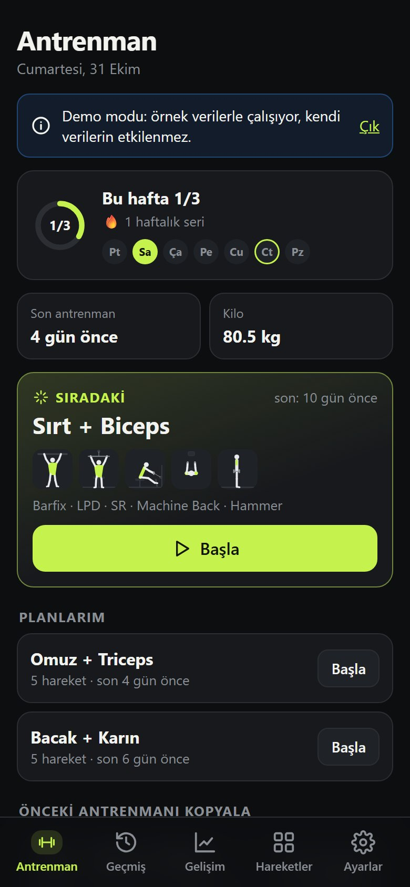
  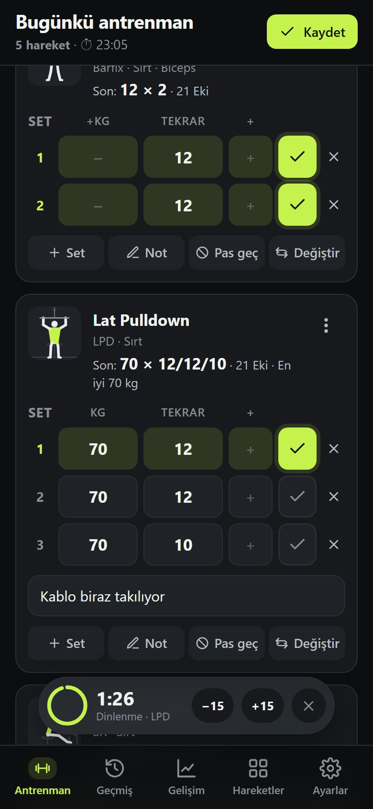
  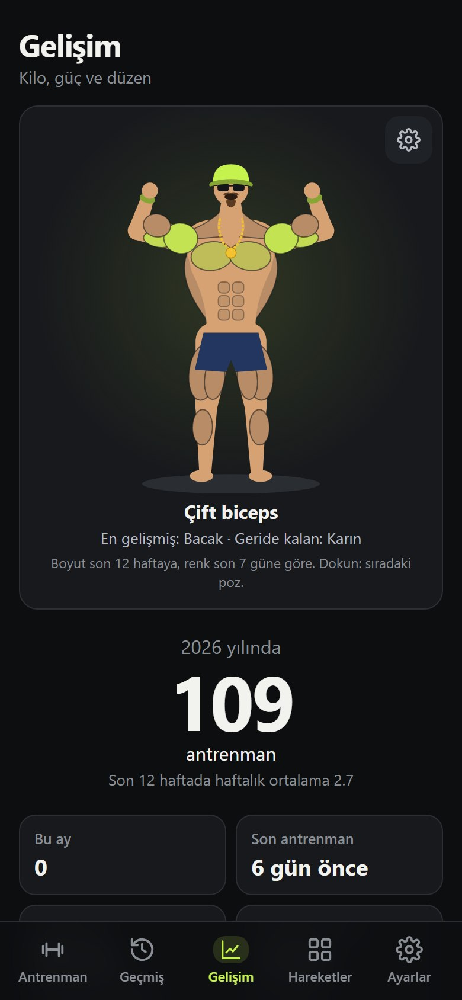
  
</p>

### Genel bakış

GymLog, telefondaki düz bir metin dosyasından doğdu: parantez içinde kiloyla bir tarih, ardından her hareket için `lpd 54x12 x3` gibi bir satır. İşe yarıyordu ama grafik yoktu, geçen haftanın rakamlarını görmek zordu ve her antrenman sıfırdan yazılıyordu.

GymLog bu hızı korur, eksikleri tamamlar. Antrenmana önceki bir antrenmanı ya da kayıtlı bir planı kopyalayarak başlarsın, dinlenme sayacı çalışırken setleri işaretlersin, artırmaya hazırsan önerilen ağırlığı alırsın ve kaydedersin. Her hareketin küçük bir animasyonu var; `LPD` ya da `D Rise` gibi kısaltmalar gözle tanınır hale gelir. Eski notlarını bir kez yapıştırman yeterli, otomatik olarak antrenmanlara çevrilir.

Telefonun tarayıcısında çalışan bir web uygulamasıdır (PWA): ana ekrana eklenebilir ve salonda internet olmasa da açılır. Sunucu ya da hesap yok; her şey cihazında saklanır. Arayüz Türkçe ve İngilizce; koyu ya da açık temada 18 vurgu rengiyle kullanılabilir. Kullanırken keyif versin diye ekranlar kayarak gelir, düğmeler dalgalanır, seti tamamlayınca telefon titrer.

### Özellikler

**Kayıt**
- Günün bölgelerini seç (göğüs, sırt, omuz, biceps, triceps, bacak, karın, kardiyo), hareketleri bu bölgelerden seç ya da adıyla veya kısaltmasıyla ara.
- Her set için ağırlık, tekrar (yazarak ya da −/+ düğmeleriyle) ve drop: setin sonunda ağırlığı düşürüp çıkardığın ekstra tekrar (`12+4`). Her kutunun altında ne olduğu yazar (KG, TEKRAR, DROP). Vücut ağırlığı, süreli ve kardiyo hareketlerinin kendi alanları var.
- Her harekette geçen seferki rakamlar görünür, kutulara da silik olarak yazılır. Yeni rekor yazarken vurgulanır.
- İlk setin ağırlığını değiştirince aynı ağırlıktaki sonraki setler de güncellenir.
- Bir hareketi aynı bölgeden başka bir hareketle değiştir, sırasını değiştir, pas geç ya da sadece o harekete not düş (ör. "alet bozuktu").
- Antrenmanın tamamı için genel not ve "nasıldı?" değerlendirmesi. Taslak sürekli kaydedilir; tarayıcı kapansa da bir şey kaybolmaz.

**Salonda**
- Setleri yaptıkça işaretle. Boş bir seti işaretlersen geçen seferki rakamlar yazılır. Set silmeden önce sorar; ✓'nin yanındaki ✕'e yanlışlıkla basınca set gitmez.
- Her şey otomatik kaydedilir, uygulamayı istediğin an arkaya atabilirsin. **Antrenmanı tamamla** önce ne olacağını gösterir: işaretlenmeyen setler pas geçilmiş sayılır. İstatistiğe girmezler ama planın küçülmez; bir dahaki antrenmanda aynı setler yine önüne gelir ve "pas geçilmişti" yazar.
- Yanlışlıkla mı bitirdin, eve gidip geri mi döndün? Bugünkü antrenmana Antrenman sekmesinden ya da Geçmiş'ten devam edebilirsin: işaretli setler işaretli kalır, süre kaldığı yerden sayar.
- Dinlenme sayacı kendiliğinden başlar; bitince titreşir ve ses çıkarır. Varsayılan süre (60 sn – 3 dk) genel olarak ve hareket başına ayarlanabilir, −15/+15 ile anında değiştirilir. Kalan süre hem sayaç kutusunun çerçevesinde hem de içinde dinlenen küçük bir figür olan halkada akar.
- Antrenman boyunca ekran açık kalır, bir saat ne kadar süredir çalıştığını gösterir. Süre antrenmanla birlikte kaydedilir.
- Süperset: bir hareketi sonrakine bağla. Bir seti işaretleyince süpersetteki sıradaki harekete geçilir; dinlenme sayacı sondakinden sonra başlar.
- Makine ayarı notları (ör. "koltuk 4, göğüs pedi 2") her seferinde hareketin üstünde görünür.
- Motivasyon sesleri (varsayılan kapalı, Ayarlar'dan açılır): antrenman ekranındaki 📣 düğmesi set öncesi rastgele bir salon sözü çalar; Ronnie Coleman'dan "Yeah buddy!" ve "Light weight baby!", David Goggins'ten "Stay hard!", "We go jim!", "Hafif bu, hafif!" ve hava kornası, vine boom, bas düşüşü gibi meme efektleri. Düğmeye basılı tutunca ses panosu açılır, favorilerini yıldızlayabilirsin.

**İlerleme**
- Ağırlık önerisi: geçen sefer bütün setleri tamamladıysan GymLog tek dokunuşla bir üst ağırlığı önerir. Bu harekette daha önce kullandığın bir sonraki ağırlığı seçer (makinenin ağırlık kademelerine uyar), yoksa olağan artışını ekler.
- Bir hareketi "bir dahakine artır" diye işaretle; öneri bir sonraki antrenmanda seni bekler.
- Aradan dönüş: iki haftadan uzun aradan sonra her hareket daha hafif başlar. Düşüş; o bölgeye ne kadar süredir çalışılmadığına (4 haftada eski ağırlığın yaklaşık %87'si, 8 haftada %75'i, 6 ayda %55'i), arada başka hareketlerle çalışılıp çalışılmadığına ve aradan önce ne kadar düzenli olduğuna göre hesaplanır. Tek dokunuşla eski rakamlara dönebilirsin. Sonrasında ağırlık bir anda eski haline fırlamaz, aradan önceki seviyeye kademeli çıkar. Bu temkinli bir kuraldır, tıbbi tavsiye değildir.
- Yeni rekor, seti işaretlediğin anda konfetiyle kutlanır; kayıt özetinde rekorların, hacim, süre ve çalışan kasların haritası görünür.

**Kopyalama ve planlar**
- Önceki herhangi bir antrenmanı tek dokunuşla kopyala, sadece değişenleri düzelt.
- Antrenmanları plan olarak kaydet. Plan başlatıldığında her hareket için en son kullandığın ağırlıklar gelir.
- "Sıradaki" kartı en uzun süredir yapmadığın planı önerir; planlar geçmişinden otomatik olarak da önerilebilir.

**Hareketler**
- Hazır 124 hareket; her birinde hareketi gösteren animasyonlu bir figür, çalışan kas vurgusu ve kısa bir teknik ipucu.
- Hareketler kasın hangi bölümüne odaklandığını söyler (uzun baş, üst göğüs, yan omuz, arka bacak…); buna göre de arayabilirsin.
- Kendi hareketini ekle: ad, kısaltma, bölgeler, kayıt türü ve 97 animasyondan biri. Hazır hareketlerin adı değiştirilebilir ya da gizlenebilir.

**Gelişim**
- Sayfanın üstünde kas gösterisi yapan bir karakter: her kasın boyutu son 12 haftadaki çalışmana, rengi son 7 güne göre değişir; bacak gününü atlarsan belli olur. Vücut geliştirme pozları verir, arkasını dönüp sırtını da gösterir.
- Boy ve cinsiyet (Ayarlar → Profil) karakteri şekillendirir: boy vücudun uzunluğunu, cinsiyet oranlarını, boy ve son kilon birlikte yapısını belirler. Bunların hepsi cihazında kalır.
- Dişli düğmesiyle karakteri kendine benzet: ten rengi, 9 saç modeli, 10 şapka (kep, silindir, viking kaskı, taç…), gözlük, sakal, altın zincir, şampiyon kemeri, pelerin, kulaklık ve daha fazlası; canlı önizleme ve rastgele düğmesiyle.
- 3 ay, 6 ay, 1 yıl ve tüm zamanlar görünümlü kilo grafiği, istersen hedef kilo çizgisi.
- Spor takvimi (ısı haritası), aylık antrenman sayısı, en uzun ara, haftalık ortalama.
- Hareket bazında gelişim: en ağır set, tahmini 1RM (Epley) ya da hacim; kişisel rekorlar.
- Haftalık hedef (ör. haftada 3 antrenman), seri sayacı, bu haftanın antrenman günleri ve 12 haftalık grafik.
- Kas haritası: önden ve arkadan çizim, son 7 günde her bölgenin aldığı set sayısına göre renklenir; haftada 10–20 set rehberiyle.
- Vücut ölçüleri (bel, göğüs, kol, uyluk, kalça): grafikler ve ilk ölçümden bu yana değişim.

**Eski notları içe aktarma**
- Telefondaki metin dosyasını yapıştır. GymLog tarih satırlarını (`02 01 26 (80.9)`), hareket satırlarını ve `50x12 x3`, `54 54 54 12 12 10+2`, `59 63 63 10x3`, `4x10 55 60 60 60`, `7(+3)` gibi yazımları okur.
- Yazım hataları en yakın harekete eşlenir (`barfiz`, `kpd`, `machin3 back`); `pass`/`skip` hareketi pas geçilmiş sayar, diğer kelimeler not olur.
- Sırası bozuk tarihler önerilen düzeltmeyle işaretlenir; içe aktarmadan önce her şeyi gözden geçirebilirsin.

### Başlarken

1. Telefonda **Chrome** ile <https://kaansoyaslan.github.io/gymlog/> adresini aç, ⋮ → **Uygulamayı yükle** (ya da **Ana ekrana ekle**) de ya da Ayarlar'daki **Uygulamayı yükle** düğmesini kullan.
2. Eski notlarını almak için: **Ayarlar → Eski notlarımı içe aktar**, metni yapıştır, önizlemeyi kontrol et ve içe aktar.
3. **Antrenman** sekmesinde bir plandan başla, önceki antrenmanı kopyala ya da boş bir antrenman başlat.
4. Arada bir yedek al (**Ayarlar → Yedeği indir**). Yedeği başka bir telefonda geri yükleyebilirsin.

Uygulama telefonun diliyle (Türkçe ya da İngilizce) açılır; **Ayarlar → Dil** bölümünden istediğin zaman değiştirebilirsin. Tema ve vurgu rengi de **Ayarlar → Tercihler** altında.

### Gizlilik

- Antrenmanlar, planlar, kendi hareketlerin ve ayarlar sadece tarayıcının yerel depolamasında (localStorage) tutulur. GitHub'a ya da başka bir sunucuya hiçbir şey gönderilmez.
- Eski notların içe aktarılması tamamen cihazda yapılır.
- Tarayıcının site verilerini silmek kayıtlarını da siler; bu yüzden yedek dosyası sakla.

### Bilgisayarda çalıştırma

Windows PowerShell ile (herhangi bir statik dosya sunucusu da olur):

```powershell
powershell -ExecutionPolicy Bypass -File serve.ps1
```

Ardından <http://localhost:8080> adresini aç. Örnek verilerle denemek için sonuna `?demo` ekle (<http://localhost:8080/?demo>); demo modu ayrı bir depolama kullanır, kendi kayıtlarına dokunmaz.

### Bilinen sınırlamalar

- Veriler tek cihazda, tek tarayıcıda durur. Başka telefona taşımak için yedek dosyasını kullan; otomatik eşitleme yok.
- Dinlenme sayacı ekran açıkken çalışır. Bir web uygulaması kilit ekranında sayaç gösteremez.
- Motivasyon seslerinde ses kaydı yok. Sözleri telefonun kendi konuşma sesi okur (yani taklit yapan bir robot gibi duyulur), efektler cihazda üretilir. iPhone'da sessiz tuşu açıksa sesler duyulmaz.
- İçe aktarma "hareket ağırlık x tekrar x set" tarzı notlara göre ayarlandı. Alışılmadık satırlar tahmin edilmez; not olarak saklanır ve kontrol için işaretlenir.
